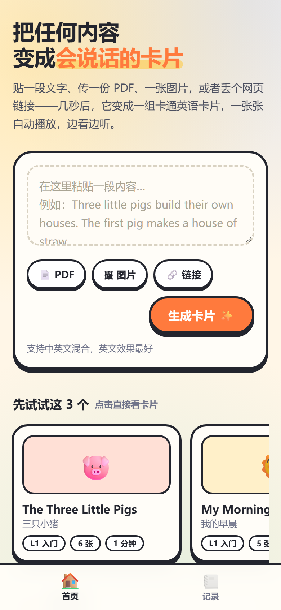
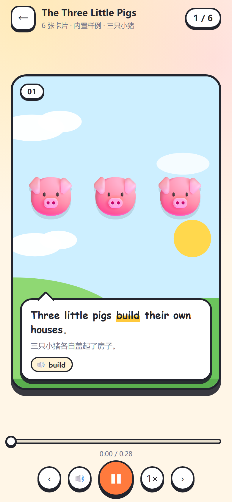
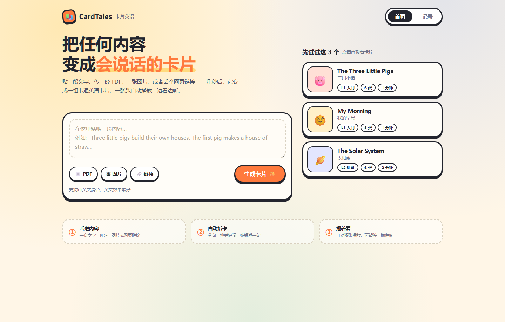
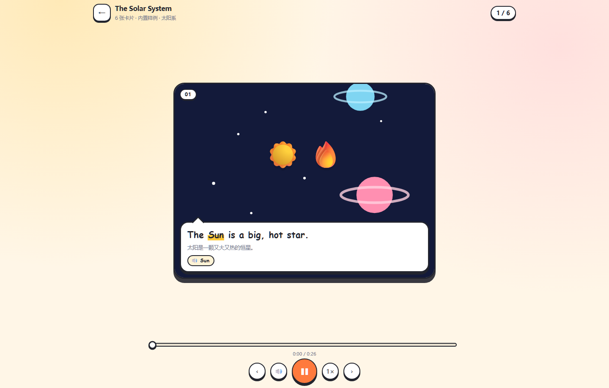

# CardTales · 卡片英语

把任何内容变成会「说话」的卡通英语卡片。贴一段文字、传一份 PDF、一张图片，或丢一个网页链接，几秒后变成一组卡通英语卡片，一张张自动播放，边看边听。

面向学龄儿童的轻量英语阅读工具，单个 HTML 文件，零构建、零依赖安装。

**在线体验**：https://chaojiman.github.io/cardtales/

## 界面

| 首页（移动） | 学习界面（移动） |
| --- | --- |
|  |  |

| 首页（桌面） | 学习界面（桌面） |
| --- | --- |
|  |  |

## 功能

- **三种输入方式**
  - 粘贴文本：支持中英混排
  - 上传 PDF：pdf.js 解析正文
  - 上传图片：OCR 识别图中文字
  - 网页链接：抓取正文（三级回退：直连 → 文本代理 → 手动粘贴）
- **本地要点提取**：分句 → 词频与句长打分 → 截短至约 15 词 → 停用词过滤 → 关键词高亮。全部在浏览器内完成，内容不上传任何服务器。
- **卡通卡片**：10 套手绘 SVG 场景（草地、夜晚、海洋、太空、房屋、森林、厨房、城市、学校、雨天），角色以 emoji 叠加，比例自适应（手机 2:3 竖版，桌面 4:3）。
- **自动播放**：逐张播放，可拖拽进度条、0.75×–1.25× 变速、语音朗读（Web Speech API）。
- **学习记录**：localStorage 保存最近 30 条，点击可继续阅读。
- **响应式**：移动端与桌面端两套布局。
- **键盘快捷键**：空格播放/暂停，← → 切卡，Esc 退出。

## 运行

无构建步骤，任选其一：

```bash
# 直接打开
start index.html        # Windows
open index.html         # macOS

# 或起一个本地静态服务（推荐，避免部分浏览器的本地文件限制）
python -m http.server 8080
```

然后访问 http://localhost:8080 。

## 技术说明

| 项 | 说明 |
| --- | --- |
| 形态 | 单文件 H5，`index.html` 约 1300 行 |
| 依赖 | 无 npm 依赖；pdf.js 3.11.174 从 CDN 按需加载 |
| 存储 | 浏览器 localStorage，无后端、无账号、无埋点 |
| 语音 | 浏览器原生 `speechSynthesis` |
| 图形 | 手写内联 SVG，无图片资源 |

## 目录结构

```
cardtales/
├── index.html        # 全部应用代码（结构 + 样式 + 逻辑）
├── assets/           # README 截图
├── README.md
└── LICENSE
```

## 隐私

应用不采集任何用户数据：输入内容、解析结果、学习记录均只存在于本地浏览器；除按需加载 pdf.js 与抓取用户主动提交的链接外，不发出网络请求。

## License

MIT © 2026 chaojiman
